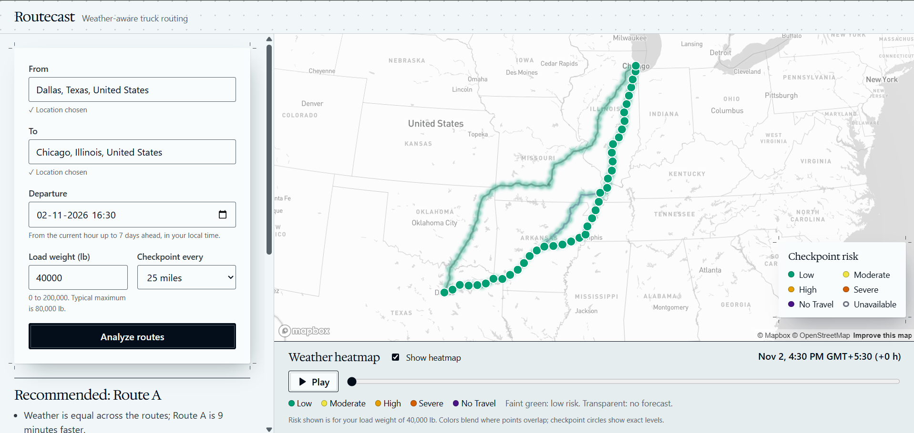

# Routecast

Weather-aware truck routing: three routes scored for weather risk at timed checkpoints, with a recommended route and a 0 to 48 hour weather heatmap.

- Live app: https://routecast-five.vercel.app/
- API health: https://routecast-api-dghk.onrender.com/api/health
- Video walkthrough: https://www.loom.com/share/a2418eb0836a4618b5c8432b774aa3e9

## What it does

Enter an origin, a destination, a departure time, the load weight and a checkpoint interval. Routecast fetches up to three driving routes and places checkpoints along each one. Each checkpoint gets its own arrival time and the forecast for that hour, and is rated from Low to No Travel. The routes are ranked by risk, then time, and one is recommended with the reason. A heatmap with an hour slider shows how the risk along the corridor changes over the 48 hours after departure.



## How the risk rules work

All numbers come from [backend/domain/constants.py](backend/domain/constants.py). Each level starts at its lower bound (inclusive) and runs up to the next bound. Values are never rounded before comparing.

| Level | Wind (mph) | Rain (in/hr) | Snow (in/hr) |
| --- | --- | --- | --- |
| 0 Low | under 25 | under 0.10 | under 0.5 |
| 1 Moderate | 25 to under 35 | 0.10 to under 0.25 | 0.5 to under 1.0 |
| 2 High | 35 to under 45 | 0.25 to under 0.50 | 1.0 to under 2.0 |
| 3 Severe | 45 to under 55 | 0.50 to 1.00 | 2.0 to 3.0 |
| 4 No Travel | 55 or more | over 1.00 | over 3.0 |

**Load rules** apply to wind only. They can raise the wind level, never lower it, and they need the load to be strictly greater than the stated weight.

| Wind | Load | Wind level becomes |
| --- | --- | --- |
| 55 mph or more | any | No Travel |
| 45 to under 55 mph | over 30,000 lb | No Travel |
| 35 to under 45 mph | over 40,000 lb | Severe |

**Checkpoint level.** Wind (after the load rules), rain and snow are rated separately, and the checkpoint takes the worst of the three. The response names the factor that set it; on a tie, wind is named first, then rain, then snow. A value the forecast does not have is skipped. With no values at all, the checkpoint is marked as having no forecast and is never counted as Low.

**Ranking.** Each checkpoint owns the miles halfway to its neighbours. Routes are compared in strict order, lowest first:

1. No Travel miles
2. Severe miles
3. High miles
4. Average risk (the mile-weighted mean level, 0 to 4)
5. Duration

Miles are compared to 0.1 mile and average risk to 3 decimals. Remaining ties go to the shorter distance, then the route order. A route with any No Travel mile is labelled Blocked. If every route is blocked, the least blocked one is recommended with a warning.

**Worked example.** A checkpoint has 40 mph wind, 0.30 in/hr rain and no snow, and the truck carries 45,000 lb.

- Wind 40 mph is High by the table. It is between 35 and 45 mph and the load is over 40,000 lb, so the load rule raises it to Severe.
- Rain 0.30 in/hr is High. Snow is Low.
- The checkpoint is **Severe, set by wind**. At exactly 40,000 lb the load rule would not apply, and the checkpoint would be High.

For the ranking, take two routes with no No Travel miles. Route A has 150 Severe miles and takes 4 h 23 min. Route B has 0 Severe miles and takes 5 h 13 min. They tie on the first key, and Route B wins on the second. The app says: "Route B has 0 Severe miles against 150 on Route A, and is 50 minutes slower."

## How a request flows

```
Browser                         API (Django)                       Providers
1. POST /api/plan ───────────▶  routes + checkpoints + ETAs ──────▶ Mapbox Directions
   ◀── weather cells and hours it needs
2. GET Open-Meteo (batches of 50 cells, 4 in parallel, cached 30 min)
3. POST /api/analyze + weather ▶ classify, score, rank (routes reused from cache)
   ◀── up to 3 routes, checkpoints, recommendation, corridor points
4. GET Open-Meteo for the corridor (0 to 48 h)
5. POST /api/heatmap + weather ▶ risk per corridor point per hour
   ◀── 49 hourly frames; the slider only switches which frame the map shows
```

The backend has four layers:

- `domain`: the rules. It imports no Django and no HTTP library.
- `providers`: Mapbox and Open-Meteo behind interfaces, with fakes for tests.
- `services`: one function per use case.
- `api`: thin views that validate, call one service and shape the response.

Requests are throttled to 30 a minute per client. If a request carries no `weather`, the server fetches it from Open-Meteo itself.

## Assumptions and decisions

These are the decisions from [docs/DESIGN.md](docs/DESIGN.md), in brief and as built.

1. **Checkpoint interval.** 10, 25 or 50 miles (default 25). Checkpoints sit at mile 0, every N miles and at the destination. Over 150 checkpoints on a route, the server moves to the next larger interval and says so.
2. **Combining factors.** Wind, rain and snow are rated separately; the checkpoint takes the worst and names the factor.
3. **Level order.** Low 0, Moderate 1, High 2, Severe 3, No Travel 4.
4. **Boundaries.** Lower bounds are inclusive, so a value shared by two ranges takes the higher level. Rain and snow keep a strict "over" for No Travel, so exactly 1.00 in/hr rain is Severe. Nothing is rounded before comparing.
5. **Wind.** Sustained wind at 10 m in mph. Gusts are not used.
6. **Rain and snow.** Rain is rain plus showers in inches per hour (unknown if either part is missing). Snow is snowfall in inches per hour.
7. **Load rules.** They apply to wind only, can only raise the level, and need a load strictly over the stated weight.
8. **Forecast hour.** The ETA rounded to the nearest UTC hour, with half past rounding up.
9. **ETA.** Departure plus the route's duration to the checkpoint, times a truck factor (default 1.10). Rest stops are not modelled.
10. **Miles per level.** Each checkpoint owns the miles halfway to its neighbours.
11. **Average risk.** The mile-weighted mean level, 0 to 4.
12. **No Travel first.** No Travel miles are the first ranking key. A route with any No Travel mile is Blocked. If all routes are blocked, the least blocked is recommended with a warning.
13. **Strict order.** Lexicographic ranking, with miles compared to 0.1 mile. The reason text gives the time difference and each route shows its duration, so the driver can overrule.
14. **Heatmap time.** Slider positions 0 to 48 are hours after departure, rounded down to the hour. The colours use the entered load, so the heatmap agrees with the route scores. If the departure hour has passed by the time the heatmap loads, it starts at the next full hour and says so.
15. **Forecast limits.** Departure must be between the current hour and 7 days ahead. A checkpoint beyond the forecast is marked as having none, left out of the mile totals, and the route shows its forecast coverage.
16. **Fewer than three routes.** Mapbox returns at most two, so a via-point search adds a third. If it finds none, the app shows what it has with a notice.
17. **Routing provider.** Mapbox Directions, behind an interface so it can be replaced.

## Known limitations

- **Free hosting sleeps.** The first request after a quiet period can take 40 to 50 seconds. An uptime monitor pings the health endpoint to keep it awake, and the app shows a "waking the server" message after 5 seconds.
- **Weather comes from the visitor's browser.** Open-Meteo's free API limits requests per IP address, and the hosted server shares its IP with other apps. The server trusts the weather values the browser sends for scoring, but validates their shape and ranges. Each visitor's own daily Open-Meteo quota applies; if it runs out, the app says which limit was reached and when to try again.
- **ETAs are simplified.** They assume continuous driving with no rest stops. Routes are car routes with a truck duration factor of 1.10. Wind is sustained wind, not gusts.
- **No antimeridian or poles.** Routes crossing the antimeridian and routes near the poles are not supported.
- **One Mapbox token.** The free account allows only one, so the same public token is used by the server and the browser. Production would use a URL-restricted browser token and a separate server token.
- **The third route is built.** Mapbox returns at most 2 routes, so the third comes from a via-point search.
- **No departure suggestions.** A short No Travel spell near departure cannot be avoided by the app suggesting a later start; the user has to change the departure time.

## Setup

Prerequisites: Git, Python 3.12 or later (tested on 3.13), Node.js 22, and a Mapbox account token.

In Windows PowerShell, from the folder you want the project in:

```powershell
git clone https://github.com/PrafulK99/routecast.git; cd routecast
Copy-Item .env.example .env        # then fill in MAPBOX_API_TOKEN and VITE_MAPBOX_PUBLIC_TOKEN
cd backend; python -m venv .venv
.\.venv\Scripts\Activate.ps1       # macOS/Linux: source .venv/bin/activate
pip install -r requirements.txt
python manage.py runserver         # API on http://localhost:8000
# In a second terminal, from the repo root:
cd frontend; npm ci
npm run dev                        # app on http://localhost:5173
```

The one `.env` file at the repo root is read by both the API and the Vite build. If PowerShell refuses to run `Activate.ps1`, first run `Set-ExecutionPolicy -Scope Process Bypass`.

| Variable | Default | Read by | Notes |
| --- | --- | --- | --- |
| `MAPBOX_API_TOKEN` | none | API | Required for routing |
| `DJANGO_SECRET_KEY` | `insecure-dev-key-change-me` | API | Set a real value in production |
| `DEBUG` | `false` | API | |
| `ALLOWED_HOSTS` | empty | API | Comma-separated; `.env.example` has `localhost,127.0.0.1` |
| `ALLOWED_ORIGINS` | empty | API | CORS origins; `.env.example` has `http://localhost:5173` |
| `TRUCK_DURATION_FACTOR` | `1.10` | API | Multiplies car durations |
| `MAX_CHECKPOINTS_PER_ROUTE` | `150` | API | Above this, the interval steps up |
| `WEATHER_CACHE_TTL_S` | `1800` | API | Only for the server's own Open-Meteo fetch |
| `NUM_PROXIES` | `1` | API | Proxies in front of the API, for the client IP used in throttling |
| `MAX_REQUEST_BYTES` | `5242880` | API | Largest request body; not in `.env.example` |
| `VITE_MAPBOX_PUBLIC_TOKEN` | none | Frontend build | Map tiles and place search |
| `VITE_API_BASE_URL` | empty (same origin) | Frontend build | `http://localhost:8000` locally |

## Tests

```powershell
cd backend; python -m pytest       # 575 tests
cd frontend; npm test              # 289 tests
```

`npm run lint` and `npm run build` check the frontend's lint rules and types. The tests use fakes and saved fixtures and make no network calls.

## Deployment

**API on Render** (web service):

- Root directory: `backend`
- Build command: `pip install -r requirements.txt`
- Start command: `gunicorn config.wsgi:application --workers 1 --threads 4 --timeout 60`
- Environment: `MAPBOX_API_TOKEN`, `DJANGO_SECRET_KEY`, `DEBUG=false`, `ALLOWED_HOSTS=routecast-api-dghk.onrender.com`, `ALLOWED_ORIGINS=https://routecast-five.vercel.app`, `NUM_PROXIES=1`

Keep one worker: the cache and the rate-limit counters live in process memory.

**Frontend on Vercel:**

- Root directory: `frontend`
- Framework preset: Vite (build `npm run build`, output `dist`)
- Environment: `VITE_API_BASE_URL=https://routecast-api-dghk.onrender.com`, `VITE_MAPBOX_PUBLIC_TOKEN`

## Credits

- [Weather data by Open-Meteo.com](https://open-meteo.com/) (CC BY 4.0)
- Routing, geocoding and map tiles by [Mapbox](https://www.mapbox.com/about/maps/)
- Map data © [OpenStreetMap contributors](https://www.openstreetmap.org/copyright)
- Headings set in Hedvig Letters Serif (SIL Open Font License 1.1, [frontend/public/fonts/OFL.txt](frontend/public/fonts/OFL.txt))
